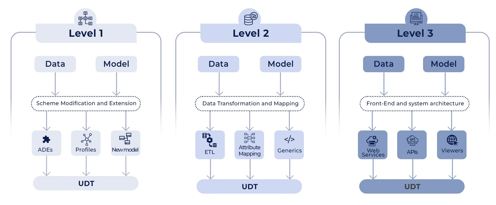

# Urban Digital Twins Levels of Integration: From Conceptualization to Technical Implementation

**Imane Jeddoub · PhD dissertation · University of Liège**

This page presents the main contributions of my PhD research, conducted at the [GeoScITY laboratory](https://www.geoscity.uliege.be/) between 2022 and 2026.

- **Supervisor:** Prof. Dr. Roland Billen
- **Co-supervisor:** Prof. Dr. Rafika Hajji
- **Institution:** University of Liège, Belgium
- **Doctoral field:** Sciences – Geography and Geoinformation
- **Defence date:** 20 April 2026
- **Funding:** Fonds de la Recherche Scientifique – FNRS, PDR SIG3.0 project

## Short summary

Urban Digital Twins integrate heterogeneous data, models, databases, services, and applications to represent and analyse urban environments and support urban decision-making. However, the diversity of these components creates major data-integration and interoperability challenges.

My PhD research introduced a framework organised around three complementary levels of data integration:

1. **Conceptual integration**, based on the modification or extension of data models;
2. **Database integration**, based on data transformation, mapping, and storage;
3. **Client and API integration**, based on web services, APIs, and interactive applications.

The framework was investigated across the Urban Digital Twin lifecycle, from creation and use to maintenance and update.

## Main contributions

- A conceptual framework for understanding data integration across the Urban Digital Twin lifecycle;
- The definition and analysis of three complementary levels of integration;
- The implementation and evaluation of these levels using 3D city models, BIM, building-energy simulations, air-quality observations, and solar-potential data;
- The design and development of the **City2Twin** platform;
- Recommendations for developing more interoperable, flexible, reusable, and maintainable Urban Digital Twins.

## Levels of integration

<figure>
  
  <figcaption>
    The three levels of data integration investigated in the PhD thesis.
  </figcaption>
</figure>

## Examination committee

- **Prof. Dr. Christophe Debruyne**, University of Liège, Belgium — Chair
- **Prof. Dr. Roland Billen**, University of Liège, Belgium — Supervisor
- **Prof. Dr. Rafika Hajji**, IAV Hassan II, Morocco — Co-supervisor
- **Prof. Dr. Volker Coors**, Stuttgart University of Applied Sciences, Germany
- **Prof. Dr. Hugo Ledoux**, 3D Geoinformation Research Group, Delft University of Technology, the Netherlands
- **Prof. Dr. Jean-Paul Kasprzyk**, University of Liège, Belgium

## Thesis and related resources

- [University of Liège defence announcement](https://www.sciences.uliege.be/cms/c_13672428/en/soutenance-de-these-d-imane-jeddoub)
- [GeoScITY announcement: PhD Defence Success for Imane Jeddoub](https://www.geoscity.uliege.be/cms/c_13683386/en/phd-defense-success-for-imane-jeddoub-on-urban-digital-twins)
- [View related publications](/publications/)
- [Explore City2Twin and research resources](/portfolio/)
